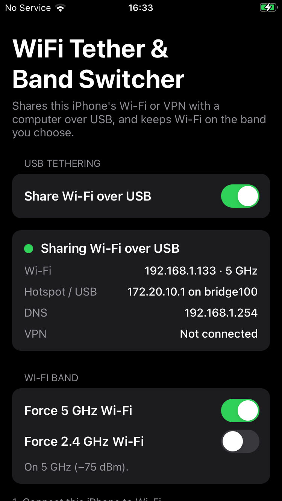
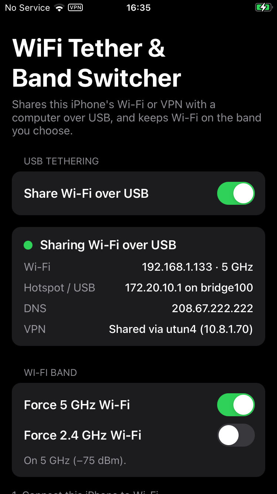

# WiFi Tether & Band Switcher: USB tethering and Wi-Fi band control for jailbroken iPhones and iPads

**Free and open source, for iPhone and iPad on rootless jailbreaks, iOS 15 and later.** Two things
in one app, called **Tether & Band** on the home screen:

- **Plug-and-play USB tethering.** Plug your iPhone or iPad into a computer and the
  computer is online through its **Wi-Fi**, or through its **VPN**. No SIM or data plan
  needed, so **Wi-Fi-only iPads** work too, and nothing to set up on the computer.
- **Wi-Fi band switcher.** Keeps it on **5 GHz** (faster) or **2.4 GHz**
  (reaches further), even when the router tries to move it. Handy with routers that won't
  let you split the bands, like BT's Smart Hub 2, Sky's Max Hub, Google Nest Wifi and eero. Works on its own,
  without tethering.

  
  
  

## Features

- **Plug and play.** Leave the switch on and just plug in: the computer is online in
  seconds, with nothing to set up. If Windows misses the connection, WiFi Tether
  retries by itself.
- **Shares your VPN.** Connect a VPN app or the built-in VPN on the iPhone and the
  computer goes through it too, DNS included.
- **Switch VPN location while plugged in.** The computer follows within a second or two.
  No unplugging, no hanging connections.
- **Full speed.** No cap: the computer gets about what the iPhone itself gets, up to
  what the USB port carries (USB 2.0 on Lightning, a few hundred Mbps). Through a VPN,
  it's as fast as the VPN runs on the phone.
- **Barely any added latency.** Tethering adds only a millisecond or two on top of the
  iPhone's own ping; the USB hop itself is under 1 ms. Through a VPN, the VPN server's
  distance adds the same as it does on the phone.
- **One switch.** Turns Personal Hotspot on, keeps Wi-Fi connected and turns airplane
  mode off if needed. Switch it off and everything goes back to how it was.
- **Force 5 GHz or 2.4 GHz.** Keeps the iPhone on the band you pick. Works on its own,
  without tethering or the Share tweak. See [Wi-Fi band switches](#wi-fi-band-switches).
- **No SIM or data plan needed.** It shares Wi-Fi, not mobile data, so it works on
  Wi-Fi-only iPads too.
- **No battery drain when it's off.** The background services sleep.
- **Free and open source** (MIT), unlike paid tweaks such as Tethera and TetherMe.

Handy when a computer has no Wi-Fi, broken Wi-Fi, or can't join a network the iPhone
can, like a captive portal you've already signed in to on the phone.

> **Beta.** Should work on any iPhone or iPad with a rootless jailbreak on iOS 15 or later,
> including Wi-Fi-only iPads (Share supports them). So far it's been tested on an iPhone 6s
> with iOS 15.8.5 (Dopamine) and a Windows PC.
> Reports from other devices are welcome; please open an issue.

## What you need

- A **rootless** jailbreak on iOS 15 or later (for example palera1n or Dopamine)
- For USB tethering: the **[Share](https://github.com/amineross/share)** tweak by
  amineross, from the repo `https://aminerostane.com/repo`. Share turns on Personal
  Hotspot without a SIM; WiFi Tether adds the internet connection on top.
  The **band switches** don't need it.
- For USB tethering: a USB cable, and a computer that supports iPhone USB tethering
  (Windows needs Apple's iPhone drivers, which come with iTunes or Apple Devices;
  macOS and most Linux distributions work out of the box)

## Install

**From Sileo (recommended):**

1. In Sileo, add the source `https://scog3.github.io/iOS-WiFi-tether/`
   (or open that page on the iPhone and tap **Add to Sileo**).
2. Install **WiFi Tether & Band Switcher**. It shows up on the home screen as
   **Tether & Band**. Installing restarts iOS's Wi-Fi service, so Wi-Fi drops for a few
   seconds.
3. For USB tethering, install the **Share** tweak: open **Tether & Band** and tap **Add Share's
   Repo in Sileo**. Sileo opens with the address filled in: tap **Add Dist Repo**, then
   **Add** (Sileo's *Add Source* can silently fail to add it). Then install Share from
   that repo. WiFi Tether picks it up as soon as it's installed.

Updates then appear in Sileo automatically.

**Or by hand:** download the latest `.deb` from this repository's
**[Releases](../../releases)** page in Safari on the iPhone, open it in **Filza** and
install it. Install **Share** from `https://aminerostane.com/repo` as well.

## Use

1. Connect the iPhone to **Wi-Fi**.
2. Open **Tether & Band** and turn **Share Wi-Fi over USB** on. It turns Personal Hotspot on for you
   and keeps Wi-Fi connected.
3. Plug the iPhone into the computer.

That's it: the computer gets an address, gateway and DNS automatically and is online.
Leave the switch on and it stays ready, including after re-jailbreaking. Switch it off
to turn Personal Hotspot off; the background services then sleep and use no battery.

| Status in the app | Meaning |
| --- | --- |
| 🟢 Sharing Wi-Fi over USB | Working |
| 🔵 Ready: plug in the USB cable | Personal Hotspot is on; plug in |
| 🔵 Waiting for the computer | Plugged in, the computer is setting up the connection; retried automatically |
| 🟠 Starting Personal Hotspot | Turning the hotspot on; see the message underneath if it stays |
| 🟠 Waiting for Wi-Fi | Connect the iPhone to a Wi-Fi network |
| 🟠 Airplane mode is on | Personal Hotspot can't run in airplane mode; turn it off |
| 🔴 Couldn't set up sharing | See the message underneath, and the log below |
| 🔴 Background service isn't running | Re-jailbreak or reinstall the package |
| ⚪ Off | The switch is off |

The **VPN** row shows *Not connected*, *Shared via utunN* (the computer's traffic goes
through the iPhone's VPN), or *not shared yet* (the VPN was just connected; give it a
couple of seconds).

## Wi-Fi band switches

Many routers use one network name for both bands and move phones between them on their
own ("band steering"), often pushing an iPhone onto slow 2.4 GHz whenever its 5 GHz
signal dips. iOS has no setting to stop that.

Turn on **Force 5 GHz** or **Force 2.4 GHz** in the app's **Wi-Fi band** section (only
one can be on). Each time the router moves the iPhone, WiFi Tether moves it straight
back:

- **iPhone X and older, and iPads with an A11 chip or older:** with a hand-over, the
  same quick switch iOS uses itself. It takes about a quarter of a second and Wi-Fi
  doesn't drop.
- **iPhone XS, XR and newer, and iPads with an A12 chip or newer:** the hand-over part
  isn't built for these yet, so it disconnects and rejoins instead. Wi-Fi drops for about
  half a second each time.

If the band you picked is too weak to connect to where you are, it waits and tries again
later instead of leaving you without Wi-Fi.

It's made for routers that won't let you give each band its own network name or turn
band steering off, like BT's Smart Hub 2, Sky's Max Hub and mesh systems such as Google
Nest Wifi and eero. If your router can split the bands, that's the simplest fix of all.

Tested on one iPhone 6s (iOS 15.8.5) and one router. What was tried along the way, what
worked and what didn't: [docs/band-switching-research.md](docs/band-switching-research.md).

## Sharing the iPhone's VPN

Connect a VPN on the iPhone and the computer's traffic follows it automatically.
Disconnect it and traffic goes straight out through Wi-Fi again.

- Works with any full-tunnel VPN that has an IPv4 address: VPN apps (WireGuard,
  sing-box / Hiddify and similar) and IKEv2 / built-in VPNs. Only IPv4 goes through
  the VPN. Split-tunnel VPNs aren't shared; traffic goes out through Wi-Fi.
- With sing-box based apps (Hiddify etc.), set the TUN stack to **mixed**, not
  *gvisor*: gvisor can run out of memory under heavy uploads and iOS stops the VPN.
- iOS limits VPN apps to 50 MB of memory. WiFi Tether raises that to 128 MB while
  sharing, slows uploads down if the VPN gets close to its limit, and restarts the
  VPN if iOS stops it anyway. The automatic restart needs **python3** (installed with
  WiFi Tether when you install from a repo; with Filza, install python3 from Sileo).
- DNS lookups from the computer go through the VPN as well.
- Don't also install the stand-alone *ios-hotspot-vpn-keepalive* `pftun`; WiFi Tether
  includes it and stops the separate copy on install.

This part is based on [pftun](https://github.com/maliv2/ios-hotspot-vpn-keepalive)
by Muhammet Ali Aydın (MIT). Upstream tested it on iOS 17.6.1; on iOS 15 it's new.

## Troubleshooting

- **"Waiting for the computer" for a long time.** The first time on a new USB port,
  Windows can miss the connection. WiFi Tether restarts the hotspot to make it try
  again; if that doesn't help, unplug and plug back in.
- **"Trust This Computer?"** That comes from Apple's software on the computer (iTunes
  or Apple Devices), which asks to pair with any iPhone it sees. Tethering doesn't use
  it, so it works whichever you tap. Tap **Trust** on your own computer and it won't
  ask again; tap **Don't Trust** and it asks every time you plug in.
- **Airplane mode.** Personal Hotspot can't run in airplane mode. Switching WiFi Tether
  on turns airplane mode off and switching it off turns it back on.

- **Personal Hotspot won't turn on by itself.** Turn it on in Settings once. Opening
  that page can disconnect Wi-Fi; WiFi Tether reconnects it within a few seconds.

- **Computer says "No internet" or "Unidentified network".** Unplug and plug the
  iPhone back in so the computer asks for a new address. On Windows,
  `ipconfig /renew` in Command Prompt does the same.
- **Slow?** The computer gets about what the iPhone's own Wi-Fi gets. The **Wi-Fi** row
  in the app shows the band: on **2.4 GHz** everything is a lot slower than on 5 GHz.
  Turn on **Force 5 GHz Wi-Fi**. Where the 5 GHz signal is weak, it can be slower or
  less stable instead.
- **Testing while the computer is also on Wi-Fi.** The computer may keep using
  its own Wi-Fi. Turn the computer's Wi-Fi off to test.
- **Log and status files** are on the iPhone in `/var/mobile/Library/WiFiTether/`
  (`daemon.log`, `vpn.log` and `status.plist`). Attach them to an issue if
  something fails. `daemon.log` stays under 1 MB; the part before that is kept in
  `daemon.log.old`.

## How it works

Share starts Apple's Personal Hotspot in a local-only mode: the computer gets an
address but has no route to the internet. WiFi Tether's background service
(`wifitetherd`, runs as root) fills that gap whenever sharing is switched on:

1. **Routing.** It turns on IP forwarding and loads NAT rules into the kernel packet
   filter through `/dev/pf` (no `pfctl` needed):
   - `nat on en0 from <hotspot subnet> to any -> <Wi-Fi address>`
   - `rdr on bridge100 proto udp/tcp to <phone> port 53 -> <Wi-Fi DNS server>`
2. **Gateway and DNS.** It adds `dhcp_router` and `dhcp_domain_name_server` to the
   hotspot's DHCP settings (`bootpd.plist`), so clients set themselves up
   automatically. It watches that file and puts the entries back the moment iOS
   rewrites it.

3. **VPN.** `src/vpn` is pftun from ios-hotspot-vpn-keepalive with a few marked
   changes. When a VPN is up, a `route-to` rule sends client traffic to pftun's own
   utun; pftun re-sends each packet through a raw socket bound to the VPN's utun,
   where a `nat` rule translates it. (Routing straight into the VPN's utun can panic
   the kernel; upstream's README explains why.) Share's local-only hotspot has no
   pf anchors of its own, so `wifitetherd` links pftun's anchor `wifitether.vpn`
   into the main ruleset with a `nat-anchor` and a filter `anchor` rule.

4. **Personal Hotspot and Wi-Fi.** The switch turns the hotspot on with the call
   Settings uses (`MISManager setState:`), adapted from
   [AutoHotspot](https://github.com/27445688/AutoHotspot). It never makes the hotspot
   visible over Wi-Fi (WiFiKit's discovery state), because that takes over the Wi-Fi
   chip and disconnects Wi-Fi. If Wi-Fi drops while the hotspot is on, it hides the
   hotspot and turns Wi-Fi back on (MobileWiFi `WiFiManagerClientSetPower`).
   Airplane mode is switched with RadiosPreferences (AppSupport), as Control Center does.
   Whether a computer is plugged in comes from IOKit's external power adapter details
   (USB host family codes).
5. **Fast reconnects.** Rules in the main filter ruleset record every new TCP
   connection from the computer, and answer packets of connections with no record
   (dropped because the route changed) with a TCP reset, so the computer reconnects at
   once instead of retrying for about a minute.

   While the switch is off, `wifitetherd` and the VPN helper wait for the notification
   `com.wifitether.changed` instead of checking every second.

6. **Wi-Fi band switches.** `wifitetherd` listens to the Wi-Fi driver's events, so it
   knows the moment the router moves the iPhone, and remembers the forced band's radio
   from a scan. It moves back with a hand-over first: a small add-on loaded into iOS's
   Wi-Fi service (`src/roam`, loaded into `wifid`) asks for iOS's own roam to that band,
   the same request iOS makes by itself when 2.4 GHz is poor. If that doesn't work, it
   disconnects and joins the forced band's radio, telling iOS to avoid the other band's
   radios for that one join. It backs off when the iPhone won't stay, and changes
   nothing about the network or its saved settings. The add-on is built for 64-bit ARM
   without pointer authentication (arm64), which is why the hand-over only works on
   A11 chips and older (iPhone X and older); A12 and newer need an arm64e build.

Everything is removed again when you switch sharing off or uninstall.

## Build it yourself

Every push to this repository builds the `.deb` on GitHub Actions (Ubuntu),
publishes the Sileo repo with GitHub Pages (`make-repo.sh`; needs
**Settings → Pages → Source: GitHub Actions**), and publishes the `.deb` as a release named after the version in `VERSION`, with that version's
notes from [CHANGELOG.md](CHANGELOG.md). Building the same version again replaces its
`.deb`; bump `VERSION` and add a changelog entry to make a new release. To build locally on Linux, install `clang`, `lld`,
`ldid` and `dpkg`, then run `bash build-linux.sh`. It builds the app, the background
service, the VPN helper and the hand-over add-on.

The script downloads an iPhone SDK (from [theos/sdks](https://github.com/theos/sdks))
and Apple's open-source XNU sources for the packet filter and other private headers.

## Credits

- **[Share](https://github.com/amineross/share)** by amineross, which makes the
  SIM-less hotspot possible. WiFi Tether depends on it.
- **[AutoHotspot](https://github.com/27445688/AutoHotspot)** by 张小生 (MIT licence,
  included in `src/daemon/LICENSE.AutoHotspot`), whose calls switch Personal Hotspot
  and Wi-Fi.
- **[pftun](https://github.com/maliv2/ios-hotspot-vpn-keepalive)** by Muhammet Ali
  Aydın (MIT licence, included in `src/vpn/LICENSE`), which does the VPN sharing.
- Packet filter structures from Apple's open-source
  [XNU](https://github.com/apple-oss-distributions/xnu).
