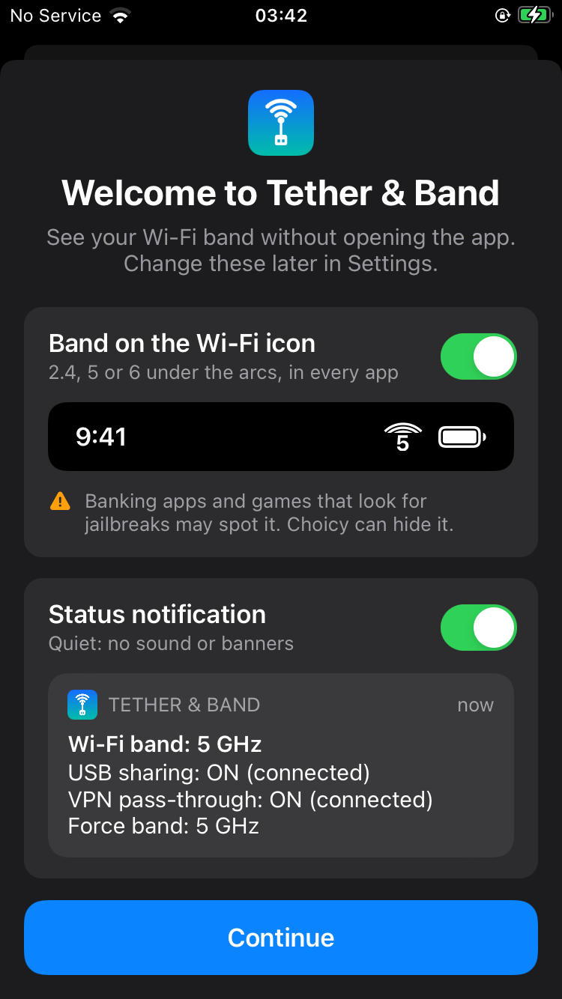
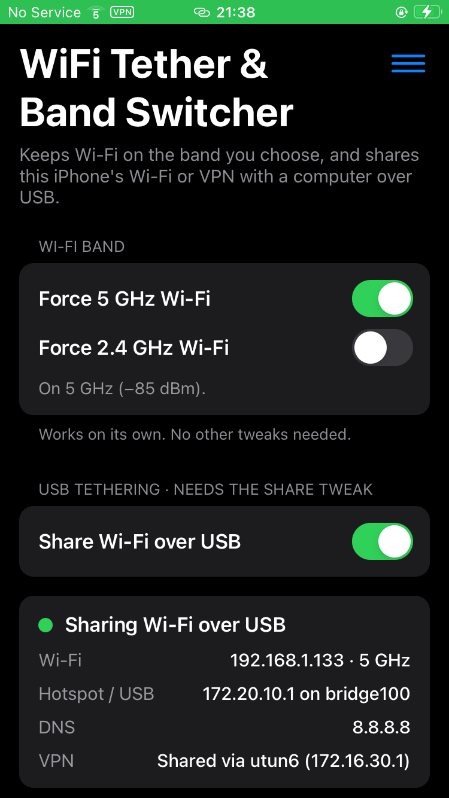
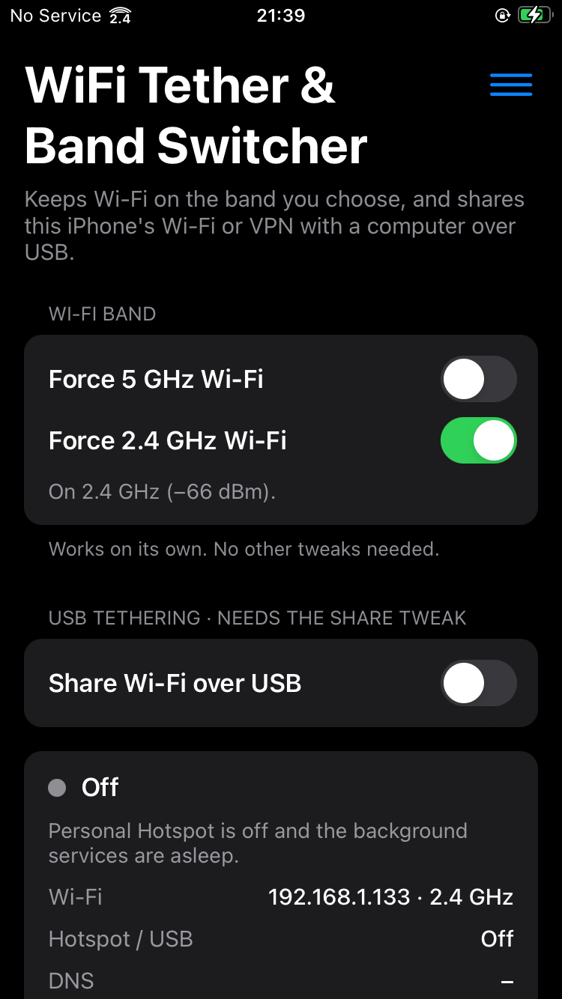

# WiFi Tether & Band Switcher: USB tethering and Wi-Fi band control for jailbroken iPhones and iPads

**Free and open source, for iPhone and iPad on rootless jailbreaks, iOS 15 and later.** Two
things in one app, called **Tether & Band** on the home screen:

- **USB tethering.** Plug your iPhone or iPad into a computer and the computer is online
  through its **Wi-Fi**, or through its **VPN**. No SIM or data plan needed, so
  **Wi-Fi-only iPads** work too, and nothing to set up on the computer.
- **Wi-Fi band switcher.** Keeps it on **5 GHz** (faster) or **2.4 GHz** (reaches
  further), even when the router tries to move it. Handy with routers that won't let you
  split the bands, like BT's Smart Hub 2, Sky's Max Hub, Google Nest Wifi and eero.

Each works on its own: use one, the other or both.

  
  
  

## Features

**USB tethering**

- **Plug and play.** Leave sharing on and just plug in: the computer is online in seconds,
  with nothing to set up. If Windows misses the connection, the app retries by itself.
- **Shares your VPN.** Connect a VPN app or the built-in VPN and the computer goes through
  it too, DNS included.
- **Switch VPN location while plugged in.** The computer follows within a second or two,
  with no unplugging and no hanging connections.
- **Full speed.** No cap: the computer gets about what the iPhone or iPad itself gets, up
  to what the USB port carries (USB 2.0 on Lightning, a few hundred Mbps).
- **Barely any added latency.** Only a millisecond or two on top of the device's own
  ping; the USB hop itself is under 1 ms.
- **One switch.** Turns Personal Hotspot on, keeps Wi-Fi connected and turns airplane mode
  off if needed. Switch it off and everything goes back to how it was.
- **No SIM or data plan needed.** It shares Wi-Fi, not mobile data, so it works on
  Wi-Fi-only iPads too.
- **No battery drain when it's off.** The background services sleep.

Handy when a computer has no Wi-Fi, broken Wi-Fi, or can't join a network the phone can,
like a captive portal you've already signed in to on the phone.

**Wi-Fi band switcher**

- **Force 5 GHz or Force 2.4 GHz.** Keeps Wi-Fi on the band you pick.
- **Moves straight back.** When the router moves the device to the other band, the app
  moves it back at once, usually without Wi-Fi dropping at all.
- **Doesn't need tethering or the Share tweak.**

**See it at a glance**

- **Band on the Wi-Fi icon.** The status bar's Wi-Fi icon shows three arcs for the
  signal over **2.4**, **5** or **6**, in every app: the band it's actually on, whatever
  the switches say. Same colour and size as iOS's icon. On by default; switch it off in
  Settings.
- **Personal Hotspot indicator.** iOS's own coloured status bar with the link icon, while
  the computer is connected, as when sharing mobile data.
- **Status notification.** A quiet notification in Notification Centre. The title is the
  band Wi-Fi is on now (*Wi-Fi band: 5 GHz*), then *USB sharing: ON (connected)*, *VPN
  pass-through: ON (not connected)* and *Force band: 5 GHz* (or OFF). No sound or banner, and it updates by itself. On
  by default.

The first time you open the app, a welcome screen shows both with a preview and a switch
each. Change them later in the app's menu (☰ top right, or swipe in from the right edge)
under **Settings**, which can also share or copy the log for a problem report. **About**
has short instructions and the version.

Both are **free and open source** (MIT).

> **Beta.** Should work on any iPhone or iPad with a rootless jailbreak on iOS 15 or later,
> including Wi-Fi-only iPads. So far it's been tested on an iPhone 6s with iOS 15.8.5
> (Dopamine), with a Windows PC and a Mac; the band switcher's hand-over on iPhone XS and
> newer hasn't been tested yet. Reports from other devices and routers are welcome; please open an issue.

## What you need

- An iPhone or iPad with a **rootless** jailbreak on iOS 15 or later (for example
  Dopamine or palera1n).
- **For USB tethering only:**
  - The **[Share](https://github.com/amineross/share)** tweak by amineross, from the repo
    `https://aminerostane.com/repo`. Share turns on Personal Hotspot without a SIM; this
    app adds the internet connection on top. The app has a button that adds Share's repo.
  - A USB cable, and a computer that supports iPhone USB tethering. Windows needs Apple's
    iPhone drivers, which come with iTunes or Apple Devices; macOS and most Linux
    distributions work out of the box. A Mac that's also on Wi-Fi keeps using its Wi-Fi
    unless you put **iPhone USB** (or **iPad USB**) first: **System Settings → Network →
    ⋯ → Set Service Order**, drag it above Wi-Fi. Or just turn the Mac's Wi-Fi off.

The band switcher needs nothing else.

## Install

**From Sileo (recommended):**

1. In Sileo, add the source `https://scog3.github.io/repo/`
   (or open that page on the device and tap **Add to Sileo**). It's my repo for all my
   projects. If you added the old `https://scog3.github.io/iOS-WiFi-tether/` source,
   remove it: it doesn't get updates any more.
2. Install **WiFi Tether & Band Switcher**. It shows up on the home screen as
   **Tether & Band**. Installing restarts iOS's Wi-Fi service, so Wi-Fi drops for a few
   seconds.
3. **For USB tethering only,** install the Share tweak: open **Tether & Band** and tap
   **Add Share's Repo in Sileo**. Sileo opens with the address filled in: tap
   **Add Dist Repo**, then **Add** (Sileo's *Add Source* can silently fail to add it).
   Then install Share from that repo. The app picks it up as soon as it's installed.

Updates then appear in Sileo automatically.

**Or by hand:** download the latest `.deb` from the **[Releases](../../releases)** page in
Safari on the device, open it in **Filza** and install it. For USB tethering, install
**Share** from `https://aminerostane.com/repo` as well.

## How to use

### USB tethering

1. Connect the iPhone or iPad to **Wi-Fi**.
2. Open **Tether & Band** and turn on **Share Wi-Fi over USB**. It turns Personal Hotspot
   on for you and keeps Wi-Fi connected.
3. Plug it into the computer with a USB cable.

That's it: the computer gets an address, gateway and DNS automatically and is online. To
share a VPN, just connect it on the device; the computer follows.

Leave sharing on and it stays ready, including after re-jailbreaking. Turn it off to turn
Personal Hotspot off; the background services then sleep and use no battery.

| Status in the app | Meaning |
| --- | --- |
| 🟢 Sharing Wi-Fi over USB | Working |
| 🔵 Ready: plug in the USB cable | Personal Hotspot is on; plug in |
| 🔵 Waiting for the computer | Plugged in; the computer hasn't picked up the hotspot yet. The app retries up to 4 times |
| 🟡 Connected to the computer | The computer has the device's network but isn't using it, as a Mac on Wi-Fi does; see [What you need](#what-you-need) |
| 🟠 Computer didn't connect | The retries are over: tap **Reconnect**, or unplug and plug back in |
| 🟠 Starting Personal Hotspot | Turning the hotspot on; see the message underneath if it stays |
| 🟠 Waiting for Wi-Fi | Connect to a Wi-Fi network |
| 🟠 Airplane mode is on | Personal Hotspot can't run in airplane mode; turn it off |
| 🔴 Couldn't set up sharing | See the message underneath, and the log below |
| 🔴 Background service isn't running | Re-jailbreak or reinstall the package |
| ⚪ Off | Sharing is off |

The **VPN** row shows *Not connected*, *Shared via utunN* (the computer's traffic goes
through the VPN), *not shared yet* (the VPN was just connected; give it a couple of
seconds), or *Connected* while sharing is off.

### Wi-Fi band switcher

1. Open **Tether & Band**.
2. In the **Wi-Fi band** section, turn on **Force 5 GHz Wi-Fi** (faster) or
   **Force 2.4 GHz Wi-Fi** (reaches further). Force 5 GHz asks you to confirm first.

The line under the switches says what it's doing, for example *On 5 GHz (−75 dBm)*. It
keeps working in the background, with sharing on or off, until you turn the switch off.
Turn it off to let the router choose again.

The band also shows on the Wi-Fi icon at the top of the screen (respring once after
installing for it to appear), and in the status notification if you turn that on in
**Settings**.

The first switch after the device has been sitting on the other band for a while can take
a few seconds while it finds the band. After that, moves are near-instant.

On routers with 6 GHz (Wi-Fi 6E), **Force 5 GHz** counts 6 GHz too, so it leaves a
device that's on 6 GHz there and the line says *On 6 GHz*. Not tested yet: there was no
6 GHz device to try it on.

## How the band switcher works

Many routers use one network name for both bands and move devices between them on their
own ("band steering"), often pushing an iPhone onto slow 2.4 GHz whenever its 5 GHz signal
dips. iOS has no setting to stop that, and routers like BT's Smart Hub 2, Sky's Max Hub
and mesh systems such as Google Nest Wifi and eero don't let you split the bands either.
If your router can give each band its own name, that's the simplest fix of all.

Each time the router moves the device, the app moves it straight back with a hand-over,
the same quick switch iOS uses itself. It takes about a quarter of a second and Wi-Fi
doesn't disconnect, though a game or a ping may notice a blip. If a hand-over doesn't
work, it disconnects and rejoins instead, which drops Wi-Fi for about half a second.

- **iPhone X and older, and iPads with an A11 chip or older:** working on an iPhone 6s, and
  the same build covers the rest of these.
- **iPhone XS, XR and newer, and iPads with an A12 chip or newer:** these need their own
  build of the hand-over part, which is new in 1.1 and **not tested on one of these
  devices yet**. The app says so when you turn a band switch on. If it doesn't work,
  you get the half-second rejoin instead. If you try it, please open an issue with your
  `daemon.log`, whether it worked or not.

If the band you picked is too weak to connect to where you are, it waits and tries again
later instead of leaving you without Wi-Fi.

Tested on one iPhone 6s (iOS 15.8.5) and one router. What was tried along the way, what
worked and what didn't: [docs/band-switching-research.md](docs/band-switching-research.md).

## Sharing a VPN

Connect a VPN on the device and the computer's traffic follows it automatically.
Disconnect it and traffic goes straight out through Wi-Fi again.

- Works with any full-tunnel VPN that has an IPv4 address: VPN apps (WireGuard,
  sing-box / Hiddify and similar) and IKEv2 / built-in VPNs. Only IPv4 goes through the
  VPN. Split-tunnel VPNs aren't shared; traffic goes out through Wi-Fi.
- With sing-box based apps (Hiddify etc.), set the TUN stack to **mixed**, not *gvisor*:
  gvisor can run out of memory under heavy uploads and iOS stops the VPN.
- iOS limits VPN apps to 50 MB of memory. The app raises that to 128 MB while sharing,
  slows uploads down if the VPN gets close to its limit, and restarts the VPN if iOS stops
  it anyway. The automatic restart needs **python3** (installed with the app when you
  install from a repo; with Filza, install python3 from Sileo).
- DNS lookups from the computer go through the VPN as well.
- Don't also install the stand-alone *ios-hotspot-vpn-keepalive* `pftun`; this app
  includes it and stops the separate copy on install.

This part is based on [pftun](https://github.com/maliv2/ios-hotspot-vpn-keepalive) by
Muhammet Ali Aydın (MIT). Upstream tested it on iOS 17.6.1; on iOS 15 it's new.

## Troubleshooting

**USB tethering**

- **"Waiting for the computer" for a long time.** Windows sometimes misses the hotspot
  coming on when the cable is already in (sharing turned on after plugging in, or a new
  USB port). Windows usually catches it within 15 seconds; if not, the app restarts the
  hotspot to make it look again, up to 4 times. If that doesn't work, tap **Reconnect**,
  or unplug and plug back in, which is usually quickest. If a laptop's USB port goes
  into power saving, the log shows `power: not plugged in` while the cable is in.
- **Mac: "iPhone USB" says *Attached* and the app says "Connected to the computer".**
  The Mac is using another connection (usually its Wi-Fi) and keeps the iPhone on
  standby. Put **iPhone USB** above Wi-Fi in **System Settings → Network → ⋯ → Set Service
  Order**, or turn the Mac's Wi-Fi off.
- **"Trust This Computer?"** That comes from Apple's software on the computer (iTunes or
  Apple Devices), which asks to pair with any iPhone it sees. Tethering doesn't use it, so
  it works whichever you tap. Tap **Trust** on your own computer and it won't ask again.
- **Airplane mode.** Personal Hotspot can't run in airplane mode. Turning sharing on turns
  airplane mode off, and turning it off turns it back on.
- **Personal Hotspot won't turn on by itself.** Turn it on in Settings once. Opening that
  page can disconnect Wi-Fi; the app reconnects it within a few seconds.
- **Computer says "No internet" or "Unidentified network".** Unplug and plug back in so
  the computer asks for a new address. On Windows, `ipconfig /renew` in Command Prompt
  does the same.
- **Computer stuck on "Identifying", or the connection keeps dropping.** The USB link
  itself keeps resetting, so the computer never finishes connecting. The log shows
  `sharing stopped (the USB network to the computer went away…)` every so often. Restart
  the iPhone or iPad first (that fixed it in testing), then try another cable or USB port
  (a port on the computer itself, not a hub), and restart the computer.
- **Slow?** The computer gets about what the device's own Wi-Fi gets. The **Wi-Fi** row
  shows the band: on **2.4 GHz** everything is a lot slower than on 5 GHz. Turn on
  **Force 5 GHz Wi-Fi**.
- **Testing while the computer is also on Wi-Fi.** The computer may keep using its own
  Wi-Fi. Turn the computer's Wi-Fi off to test (on a Mac, see above).

**Wi-Fi band switcher**

- **Wi-Fi blips now and then.** That's the router moving the device to the other band and
  the app moving it straight back. Where the hand-over doesn't work, each move back drops
  Wi-Fi for about half a second.
- **The first switch takes a few seconds.** Normal after the device has sat on the other
  band for a while: it has to find the band first. If iOS won't look for it, the app
  turns Wi-Fi off and on by itself (at most every 10 minutes), the same as doing it in
  Settings. If it ever seems stuck, turning Wi-Fi off and on yourself sorts it too.
- **"Paused for a few minutes" or "Couldn't stay on 5 GHz".** The router keeps moving it
  back faster than it can stay, usually because the 5 GHz signal is weak where you are.
  It tries again by itself; moving closer to the router helps.
- **"5 GHz isn't in range" or "too weak here".** The band you picked can't be used where
  you are, so it stays on the other one for now and checks again every few minutes.
- **Slower or less stable on 5 GHz.** Where the 5 GHz signal is weak, 2.4 GHz can be the
  better choice; try Force 2.4 GHz.

**Band on the Wi-Fi icon and status notification**

- **No number on the Wi-Fi icon.** Respring once after installing or updating: apps and
  the home screen pick the add-on up when they start. Check it's on in **Settings**.
- **An app or game says it's jailbroken, or misbehaves.** The Wi-Fi icon add-on loads into
  every app. Switching it off in Settings stops it drawing anything, but it still loads;
  to keep it out of one app, use a tweak like Choicy.
- **No status notification.** Allow notifications for **Tether & Band** in Settings →
  Notifications. If it isn't in that list, respring; if it's still missing, reboot
  userspace in your jailbreak app (Dopamine: Reboot Userspace). If you clear it, it comes
  back at the next change.

**The log:** in the app, **☰ → Settings → Share log file…** (AirDrop, Save to Files, Mail…)
or **Copy log**. Attach it to an issue if something goes wrong. The files themselves are in
`/var/mobile/Library/WiFiTether/` (`daemon.log`, `vpn.log` and `status.plist`).
`daemon.log` stays under 1 MB; the part before that is kept in `daemon.log.old`.

## How it works

Share starts Apple's Personal Hotspot in a local-only mode: the computer gets an address
but has no route to the internet. The app's background service (`wifitetherd`, runs as
root) fills that gap whenever sharing is on:

1. **Routing.** It turns on IP forwarding and loads NAT rules into the kernel packet
   filter through `/dev/pf` (no `pfctl` needed):
   - `nat on en0 from <hotspot subnet> to any -> <Wi-Fi address>`
   - `rdr on bridge100 proto udp/tcp to <phone> port 53 -> <Wi-Fi DNS server>`
2. **Gateway and DNS.** It adds `dhcp_router` and `dhcp_domain_name_server` to the
   hotspot's DHCP settings (`bootpd.plist`), so clients set themselves up automatically.
   It watches that file and puts the entries back the moment iOS rewrites it.
3. **VPN.** `src/vpn` is pftun from ios-hotspot-vpn-keepalive with a few marked changes.
   When a VPN is up, a `route-to` rule sends client traffic to pftun's own utun; pftun
   re-sends each packet through a raw socket bound to the VPN's utun, where a `nat` rule
   translates it. (Routing straight into the VPN's utun can panic the kernel; upstream's
   README explains why.) Share's local-only hotspot has no pf anchors of its own, so
   `wifitetherd` links pftun's anchor `wifitether.vpn` into the main ruleset with a
   `nat-anchor` and a filter `anchor` rule.
4. **Personal Hotspot and Wi-Fi.** Sharing turns the hotspot on with the call Settings
   uses (`MISManager setState:`), adapted from
   [AutoHotspot](https://github.com/27445688/AutoHotspot). It never makes the hotspot
   visible over Wi-Fi (WiFiKit's discovery state), because that takes over the Wi-Fi chip
   and disconnects Wi-Fi. If Wi-Fi drops while the hotspot is on, it hides the hotspot and
   turns Wi-Fi back on (MobileWiFi `WiFiManagerClientSetPower`). Airplane mode is switched
   with RadiosPreferences (AppSupport), as Control Center does. Whether anything is
   plugged in comes from the phone's own USB entries in the I/O registry: which USB
   configuration the computer picked (`IOUSBDeviceInterface`), whether it includes the
   tethering network (`AppleUSBEthernet`), and whether the computer is using it
   (`HostAttached` on `AppleUSBEthernetDevice`). Where those aren't there, the battery's
   `ExternalConnected` and adapter details (`IOPMPowerSource`) decide.
5. **Fast reconnects.** Rules in the main filter ruleset record every new TCP connection
   from the computer, and answer packets of connections with no record (dropped because
   the route changed) with a TCP reset, so the computer reconnects at once instead of
   retrying for about a minute.

   While sharing and the band switches are off, `wifitetherd` and the VPN helper wait for
   the notification `com.wifitether.changed` instead of checking every second.
6. **Wi-Fi band switcher.** `wifitetherd` listens to the Wi-Fi driver's events, so it
   knows the moment the router moves the device. It moves back with a hand-over first: a
   small add-on loaded into iOS's Wi-Fi service (`src/roam`, loaded into `wifid`) asks for
   iOS's own roam to that band, the same request iOS makes by itself when 2.4 GHz is poor.
   iOS picks the radio, so this needs no scan. The first hand-over after the device has
   sat on one band for a while often doesn't move it, since the chip hasn't seen the
   other band lately. Then the app looks up the forced band's radio among the networks
   iOS has seen recently, or scans for it and tries the hand-over once more. If that
   doesn't work either, it disconnects and joins the radio, telling iOS to avoid the
   other band's radios for that one join. If iOS won't scan, it turns Wi-Fi off and on
   (at most every 10 minutes). It backs off when the device won't stay, and changes
   nothing about the network or its saved settings. The add-on is built twice: arm64 for A11 chips
   and older, and arm64e (with pointer authentication) for A12 and newer. If iOS's Wi-Fi
   service restarts straight after a hand-over request, the app stops asking for
   hand-overs until the switch is turned off and on.

7. **Band on the Wi-Fi icon.** Since iOS 13 every app draws its own status bar, so a
   small add-on (`src/bar`) loads into every app that uses UIKit, SpringBoard included.
   On `_UIStatusBarWifiSignalView` it adds one layer in the icon's own colour on top of
   iOS's drawing, and a mask in the new shape (three arcs over the number; solid, dimmed
   for weak bars the way iOS dims them, clear elsewhere), so what shows is exactly the new
   icon, inside the old one's box. Its only hooks are that view's `layoutSubviews`,
   `applyStyleAttributes:` (colours) and `setNumberOfActiveBars:` (signal), which still
   run as before. If that view isn't there on some iOS version, it does nothing. `wifitetherd` publishes the band on the Darwin notification
   `com.wifitether.band`, so switching it off in Settings takes it away everywhere at once.
   In SpringBoard the same add-on makes iOS's Personal Hotspot indicator show
   (`src/bar/hotspot.m`). SpringBoard takes the tethering state from the cellular
   service (`-[SBTelephonyManager _setIsNetworkTethering:withNumberOfDevices:]`), which
   never says it's tethering when the hotspot shares Wi-Fi. `wifitetherd` posts the
   hotspot service's connection count (`com.wifitether.hotspot`), and the add-on merges
   it into that state, then asks the status bar to update. What it did goes in
   `springboard.log`.
   Like the hand-over add-on, it's built for arm64 and arm64e.
8. **Status notification.** Only the app can post notifications, so `wifitetherd` writes
   a short summary (`summary.plist`) and, when it changes for 3 seconds, starts the app in
   the background (`SBSLaunchApplicationWithIdentifier`, as the `open` command does). The
   app replaces its one notification in place (passive interruption level: no sound, no
   banner) and quits, so the next change starts it afresh. Jailbreak apps count as system
   apps to iOS, which only lists one in Settings → Notifications if its `Info.plist` has
   `SBAppUsesLocalNotifications`; there's no "Allow Notifications?" question for them.

Everything is removed again when you turn sharing off or uninstall.

## Build it yourself

Every push to this repository builds the `.deb` on GitHub Actions (Ubuntu), publishes it
as a release called *Tether & Band* with the version in `VERSION` and that version's notes
from [CHANGELOG.md](CHANGELOG.md), and adds it to the Sileo repo. Building the same version
again replaces its `.deb`; bump `VERSION` and add a changelog entry to make a new release.

The Sileo repo is a separate GitHub repository, one for all my projects
(`REPO_REPOSITORY` and `REPO_URL` at the top of `.github/workflows/build.yml`). Each build
runs `make-repo.sh` on a copy of it: that replaces this package's `.deb` (other packages
are left alone), writes its pages under `packages/com.wifitether/`, rebuilds `Packages`,
`Release` and the home page from every package in it, and pushes it back. Setting it up,
once:

1. Create a public repository called `repo`, with **Add a README file** ticked.
2. In it, **Settings → Pages**: **Deploy from a branch**, branch **main**, folder **/ (root)**.
   It's then at `https://<user>.github.io/repo/`.
3. Make a token that can write to it: **Settings → Developer settings → Personal access
   tokens → Fine-grained tokens → Generate new token**, **Only select repositories** →
   `repo`, **Permissions → Contents: Read and write**.
4. In this repository, **Settings → Secrets and variables → Actions → New repository
   secret**: name `REPO_TOKEN`, value the token.

Without the secret, the release still goes out and the run's summary says the repo wasn't
updated. The repo's icon is `CydiaIcon.png` in it: the first build puts this app's icon
there, and it's never replaced, so you can swap in your own. Another project can publish
to the same repo with a copy of `make-repo.sh` (change its "This package" part) and the
same workflow step.

The hand-over add-on's arm64e part is built with Apple's compiler on a GitHub Mac runner
(the `roam` job), because the open-source compiler on Linux can't make a proper arm64e
build yet; the Linux build then packages it. If that job fails, the release goes ahead
with an arm64-only add-on. Each run's page says which it got, at the top of its summary
(*Hand-over add-on: arm64 arm64e* when the Mac part made it in, or a warning when it
didn't), and the release notes end with the same line.

To build locally on Linux, install `clang`, `lld`, `ldid` and `dpkg`, then run
`bash build-linux.sh`. It builds the app, the background service, the VPN helper and the
hand-over add-on (arm64 only, unless `ROAM_DYLIB` points to a prebuilt one). The script downloads an iPhone SDK (from
[theos/sdks](https://github.com/theos/sdks)) and Apple's open-source XNU sources for the
packet filter and other private headers.

## Credits

- **[Share](https://github.com/amineross/share)** by amineross, which makes the SIM-less
  hotspot possible. USB tethering depends on it.
- **[AutoHotspot](https://github.com/27445688/AutoHotspot)** by 张小生 (MIT licence,
  included in `src/daemon/LICENSE.AutoHotspot`), whose calls switch Personal Hotspot and
  Wi-Fi.
- **[pftun](https://github.com/maliv2/ios-hotspot-vpn-keepalive)** by Muhammet Ali Aydın
  (MIT licence, included in `src/vpn/LICENSE`), which does the VPN sharing.
- Packet filter structures from Apple's open-source
  [XNU](https://github.com/apple-oss-distributions/xnu).
